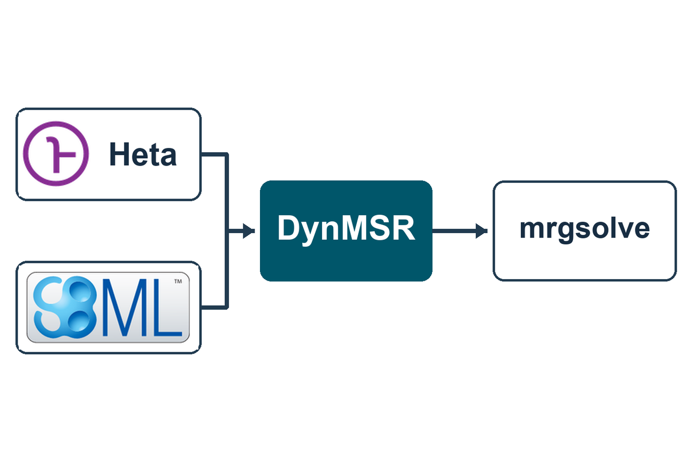

Happy to announce that **DynMSR** is now available on [CRAN](https://cran.r-project.org/web/packages/DynMSR/index.html). The R package connects systems biology and systems pharmacology models to simulation workflows in R.

DynMSR supports Heta and SBML models and can prepare them for simulation with [mrgsolve](https://mrgsolve.org/).

DynMSR is part of the [Heta project](https://hetalang.github.io/), which develops tools for building and working with reusable models.

Install DynMSR from CRAN:

```r
install.packages("DynMSR")
```

Find guides and examples on [GitHub](https://github.com/hetalang/DynMSR).
