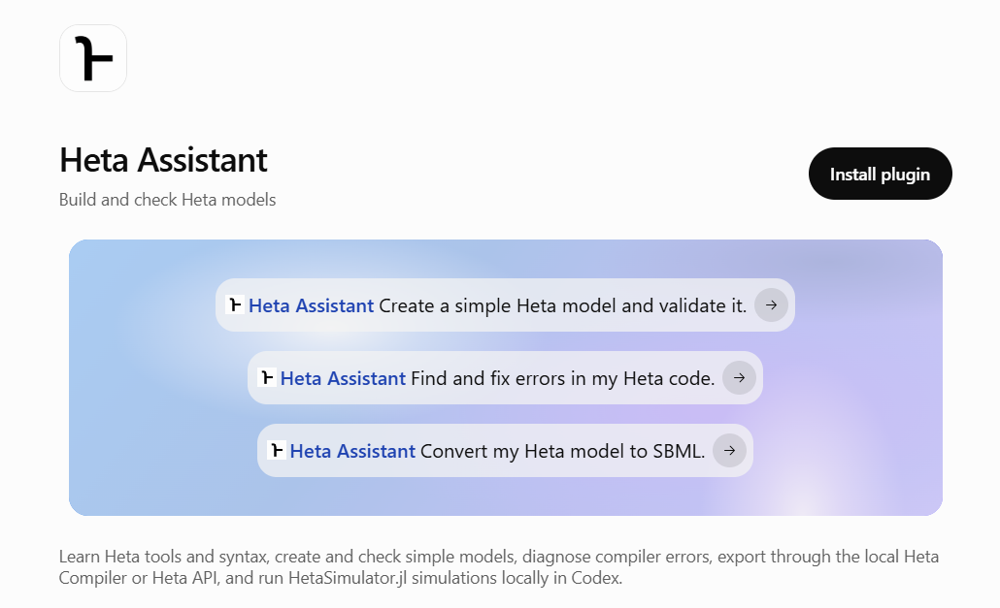

---
layout: post.njk
title: 'Heta Assistant is available in ChatGPT and Codex'
date: 2026-11-17
lastModified: 2026-11-17
description: 'Build and check systems biology and pharmacology models with Heta Assistant in ChatGPT and Codex.'
author: Evgeny Metelkin
authorURL: https://metelkin.me
canonical: https://metelkin.me/heta-assistant-on-openai/
openGraph:
    title: 'Heta Assistant is available in ChatGPT and Codex'
    description: 'Build and check systems biology and pharmacology models with Heta Assistant in ChatGPT and Codex.'
    url: https://metelkin.me/heta-assistant-on-openai/
    image: https://metelkin.me/heta-assistant-on-openai/img/fig0-cover.png
    site_name: Evgeny Metelkin
    type: article
tags:
    - post
    - featured
    - software
    - qsp-modeling
    - systems-pharmacology
    - LLM
    - AI
---

You can now build and check QSP models with an AI assistant, directly in ChatGPT. Heta Assistant is available in the plugin directory for ChatGPT and Codex.

I built it to help turn systems biology and pharmacology questions into models you can check, explore, and use.

What can you do with it?

- Describe a system in plain language and get a model that is compiled and checked for errors.
- Understand model code, diagnose errors, and ask how to use the modeling tools.
- Generate files and projects for MATLAB, R, SimBiology, Julia and SBML workflows.
- View reaction diagrams and open models in a browser app for test simulations.
- In Codex, develop local modeling projects and run simulations in your own environment.

Find [Heta Assistant in the Plugin Directory](https://chatgpt.com/plugins/plugin_asdk_app_6ad8633bb8cc8191b04155d82e587f59).

To try it, ask: "Create a simple A => 2B + 3C reaction model, check and compile it."
