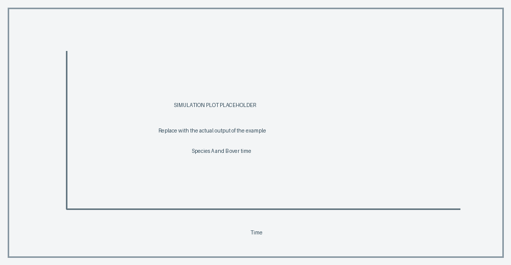

Models written in Heta can be brought into R for simulation and analysis. In this example, we will use **DynMSR** to load a small Heta project and build a model for simulation with **mrgsolve**.

[DynMSR is available on CRAN](/dynmsr-on-cran/) and is part of the [Heta project](https://hetalang.github.io/), a language and toolchain for building structured, reusable models. DynMSR uses Heta Compiler to convert the project before preparing the model for mrgsolve.

## A simple Heta model

Create a directory for the model and save the following as `index.heta` inside it:

```text
comp1 @Compartment .= 1;

A @Species { compartment: comp1 } .= 10;
B @Species { compartment: comp1 } .= 0;
r1 @Reaction { actors: A => 2B } := k1 * A * comp1;

k1 @Const = 1.2e-1;
```

The model describes a reaction in which one unit of A produces two units of B. Its rate depends on A and the rate constant `k1`.

## Install the tools

Install DynMSR and mrgsolve from CRAN:

```r
install.packages("DynMSR")
install.packages("mrgsolve")
```

Loading a Heta project also requires a compatible installation of Heta Compiler. See the [DynMSR README](https://github.com/hetalang/DynMSR) for setup instructions and the supported compiler version.

## Convert and simulate the model

Load the project, select its model, and build it for mrgsolve. Replace the path with the directory containing `index.heta`:

```r
library(DynMSR)
library(mrgsolve)

platform <- heta_load("path/to/heta-quick-start")
model <- get_model(platform, 1)
mrgsolve_model <- build_mrgsolve(model)

result <- mrgsim(mrgsolve_model, end = 100, delta = 1)
plot(result)
```



*Placeholder: replace with the actual simulation output for this example.*

The simulation results can then be explored further with the tools available in R and mrgsolve. For more examples and package documentation, see [DynMSR on GitHub](https://github.com/hetalang/DynMSR).
