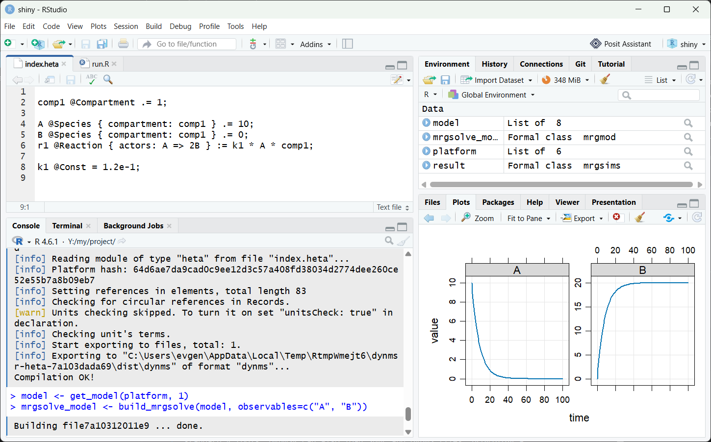
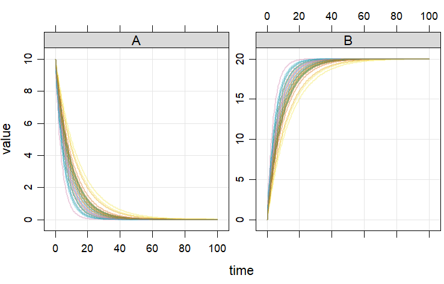

The [Heta project](https://hetalang.github.io/) provides a language and toolchain for building **complex mechanistic models**. Heta models can be split into reusable modules, checked together, and exported to different formats-useful for **large QSP models** that should not be tied to one simulation environment.

With [DynMSR](https://cran.r-project.org/package=DynMSR), Heta models can now be loaded directly **into R**. The **Heta Compiler** package turns a project into a model ready for simulation. DynMSR is available **from CRAN**.

Simulation is handled by [mrgsolve](https://mrgsolve.org/), an established R package for ODE-based models in **pharmacometrics and drug development**. It combines a compiled simulation engine with R tools for parameter exploration and population simulation.

## Quick start

### Install the tools

```r
install.packages(c("DynMSR", "mrgsolve"))
```

Loading Heta projects also requires Heta Compiler. Follow the [installation guide](https://hetalang.github.io/hetacompiler/installation.html) for your operating system, or download an installer from the [latest release](https://github.com/hetalang/heta-compiler/releases/latest).

After installation, DynMSR can check that the `heta` command is available and that its version is supported:

```r
library(DynMSR)
heta_check()
```

### Create a Heta model

Create a directory and add a plain-text file named `index.heta` in RStudio:

```text
comp1 @Compartment .= 1;

A @Species { compartment: comp1 } .= 10;
B @Species { compartment: comp1 } .= 0;
r1 @Reaction { actors: A => 2B } := k1 * A * comp1;

k1 @Const = 1.2e-1;
```

This model converts one unit of `A` into two units of `B` at a rate determined by `A` and `k1`.

### Load and simulate

Run the R code from the directory containing `index.heta` (or replace `"."` with its path):

```r
library(DynMSR)
library(mrgsolve)

platform <- heta_load(".")
model <- get_model(platform, 1)
mrgsolve_model <- build_mrgsolve(model, observables = c("A", "B"))

result <- mrgsim(mrgsolve_model, end = 100, delta = 1)
plot(result, A + B ~ time)
```

`build_mrgsolve()` returns a regular mrgsolve model, so the standard mrgsolve API remains available.

We can also use the model for a simple population simulation. Here, `k1` varies randomly between virtual individuals, producing a family of possible trajectories:

```r
idata <- expand.idata(k1 = 0.12 * exp(rnorm(30, 0, 0.35)))
mrgsim(mrgsolve_model, idata = idata, end = 100, delta = 0.5) |>
  plot(A + B ~ time, lwd = 2, alpha = 0.35)
```



## Where to go next

Beyond Heta, DynMSR can load SBML and DynMS files and use them in the same mrgsolve workflow.

See the [DynMSR documentation](https://cran.r-project.org/package=DynMSR) and [source code on GitHub](https://github.com/hetalang/DynMSR) for more examples.
