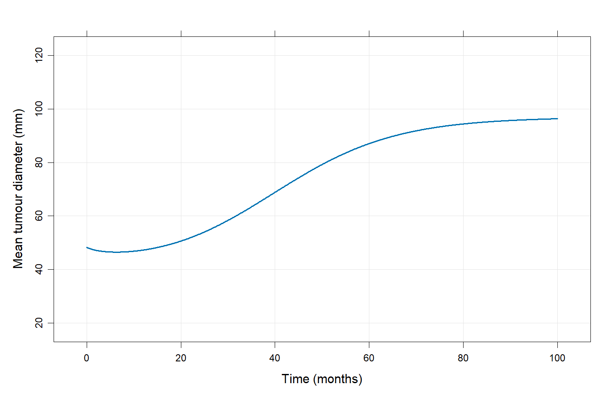
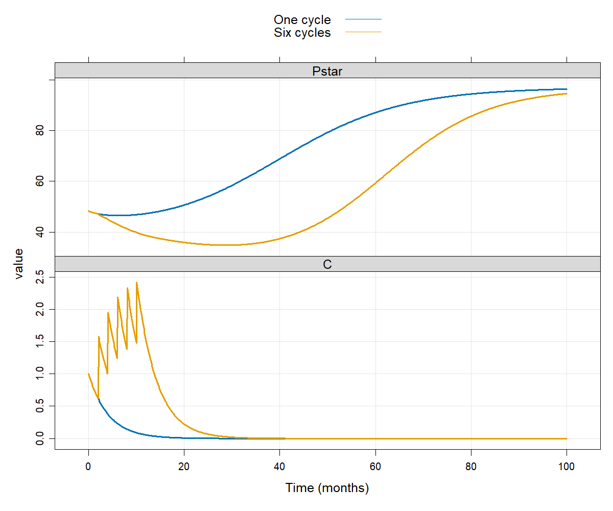

Published models can save us weeks of work. A biological mechanism has already been formulated, its equations described, and a machine-readable version deposited in a database. Yet reusing that model often starts with an unnecessary task: rewriting the equations for another simulation environment.

**What if we could download an SBML model and run it directly from R?**

[BioModels](https://www.ebi.ac.uk/biomodels/) provides a large collection of published mechanistic models, many available in **SBML**. With [DynMSR](https://cran.r-project.org/package=DynMSR), we can bring those models into R, build them for simulation with **mrgsolve**, and begin exploring their behavior without manually transcribing the equations.

In this guide, we will run a model of glioma growth and treatment, then add repeated treatment cycles using a few lines of Heta code.

## What DynMSR does

[DynMSR](https://github.com/hetalang/DynMSR) provides an R interface for models in SBML, Heta, and DynMS formats. It loads a model platform, lets us select a model, and builds an mrgsolve simulation object.

The same workflow also supports extensions: we can include the original SBML as a module in a Heta project and add new components or treatment events around it.

## Install the tools

Install the R packages:

```r
install.packages(c("DynMSR", "mrgsolve"))
```

Install **Heta Compiler** using the [instructions for your operating system](https://hetalang.github.io/hetacompiler/installation.html). mrgsolve also needs a working C++ toolchain; see its [installation guide](https://mrgsolve.org/user-guide/install.html).

The example below was checked with DynMSR 0.1.2, mrgsolve 2.0.1, and Heta Compiler 0.12.3.

## Download a model from BioModels

We will use [BIOMD0000000521](https://www.ebi.ac.uk/biomodels/BIOMD0000000521), a model associated with [Ribba et al. (2012), *A Tumor Growth Inhibition Model for Low-Grade Glioma Treated with Chemotherapy or Radiotherapy*](https://doi.org/10.1158/1078-0432.CCR-12-0084).

The model describes proliferating tumour tissue (`P`), quiescent tissue (`Q`), and damaged quiescent tissue (`Qp`). Their sum, `Pstar`, represents mean tumour diameter. Treatment can eliminate proliferating tissue and damage quiescent tissue; damaged tissue can subsequently recover or be lost. These processes allow the model to describe a delayed response and subsequent tumour regrowth.

The fourth variable, `C`, represents the concentration of a **virtual drug** combining the effects of the PCV regimen. It decays exponentially. Its units are arbitrary: this is a simplified treatment-exposure model, rather than separate PK models for the three drugs.

Download the [SBML XML file](https://www.ebi.ac.uk/biomodels/model/download/BIOMD0000000521?filename=BIOMD0000000521_url.xml) and keep the original filename. The available version is **SBML Level 2 Version 4**.

Use this directory structure:

```text
ribba2012/
    BIOMD0000000521_url.xml
    run-1.R
    index.heta
    run-2.R
```

Only the XML file and `run-1.R` are needed for the first step.

## Step 1: run the downloaded model

Put the following code in `ribba2012/run-1.R`:

```r
library(DynMSR)
#heta_check() # to check heta installation
library(mrgsolve)

# compile SBML as platform, get the model, and build for mrgsolve
platform <- sbml_load("ribba2012/BIOMD0000000521_url.xml") 
model <- get_model(platform, 1) 
mrgs_model <- build_mrgsolve(model, observables = "Pstar") 

# simulate and plot results
sim1 <- mrgsim(mrgs_model, end = 100, delta = 0.1)
plot(sim1, Pstar ~ time, ylim = c(20, 120),
     xlab = "Time (months)", ylab = "Mean tumour diameter (mm)")
```

We select the model, build it, and simulate it over 100 months. The original equations, parameters, and initial conditions remain in the downloaded SBML file.



_Simulation generated with the R code above, using the downloaded SBML model without changes._

The simulation reproduces the curve in the [BioModels curation image](https://www.ebi.ac.uk/biomodels/model/download/BIOMD0000000521?filename=curation_image.png) to the precision of the reference image.

## Step 2: add repeated treatment cycles with Heta

**What happens if treatment is repeated instead of given only once?** Include the SBML and add a treatment schedule in `ribba2012/index.heta`:

```text
// Original SBML, unchanged.
include ./BIOMD0000000521_url.xml type sbml;

// Five extra cycles; C(0) = 1 already supplies the first.
repeat_cycle @TimeSwitcher { start: 2, period: 2, stop: 10 };

// Add one dose; the paper instead resets C to 1.
C [repeat_cycle]= 1 + C;
```

This illustrative schedule gives six cycles at months 0, 2, 4, 6, 8, and 10. In `ribba2012/run-2.R`, load the model once and switch the periodic event off or on:

```r
# Run from the directory containing ribba2012/.
library(DynMSR)
library(mrgsolve)

# Load and compile once.
mrgs_model <- heta_load('ribba2012') |>
  get_model(1) |>
  build_mrgsolve(observables = c('C', 'Pstar'))

# One cycle: periodic event off.
single <- param(mrgs_model, repeat_cycle__active__ = 0) |>
  mrgsim_df(end = 100, delta = 0.1)
# Six cycles: periodic event on.
repeated <- param(mrgs_model, repeat_cycle__active__ = 1) |>
  mrgsim_df(end = 100, delta = 0.1)

# Compare exposure and tumour response.
comparison <- rbind(
  transform(single, scenario = 'One cycle'),
  transform(repeated, scenario = 'Six cycles')
)
plot_sims(comparison, C, Pstar, .dots = list(
  groups = comparison$scenario,
  layout = c(1, 2),
  xlab = 'Time (months)',
  auto.key = list(space = 'top', lines = TRUE, points = FALSE)
))
```



The repeated cycles sustain exposure and produce a deeper, longer response. In this scenario, the minimum diameter is approximately **34.85 mm at 28.7 months**, well after the final cycle at month 10. The delayed response reflects the model's damaged-tissue dynamics. Tumour growth eventually resumes as treatment exposure declines.

This is an exploratory simulation of the BioModels version, with its documented differences from the paper. It demonstrates how to extend and interrogate a model; it does not establish a clinical treatment schedule.

## Start from an existing model

The workflow is small: **download an SBML model, load it in R, and simulate it**. When a new experiment requires changes, Heta can connect the original model to additional components or events, while R remains the environment for simulation and analysis.

For your own model, begin by comparing the imported simulation with an available reference. Then explore the question that matters to your project: a different treatment schedule, a parameter change, or a new model component.

Try [DynMSR](https://cran.r-project.org/package=DynMSR) with a model from BioModels. Examples and the issue tracker are available in the [DynMSR repository](https://github.com/hetalang/DynMSR).

<!-- Before publication: review the BioModels-versus-paper caveat and final social preview. Keep the draft tag until ready to publish. -->
